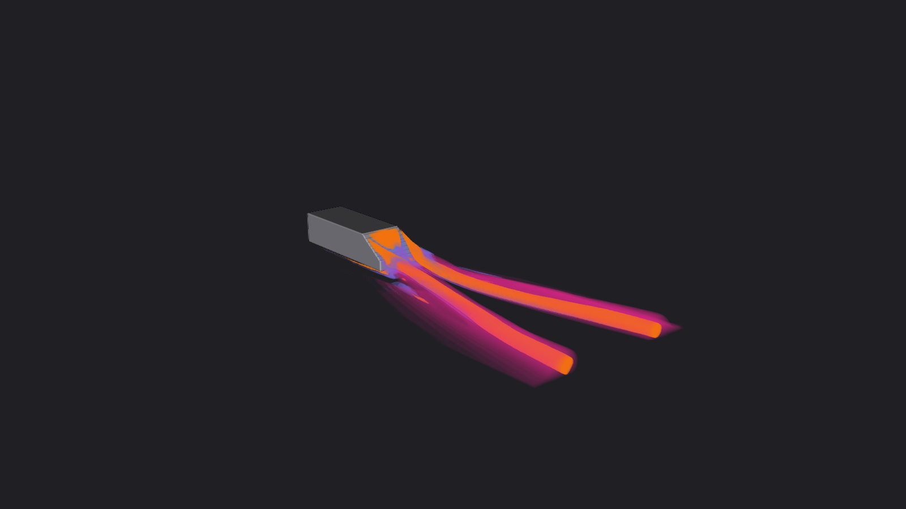
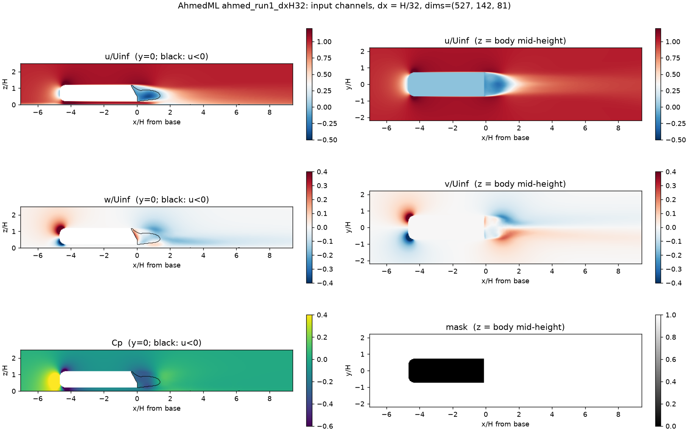
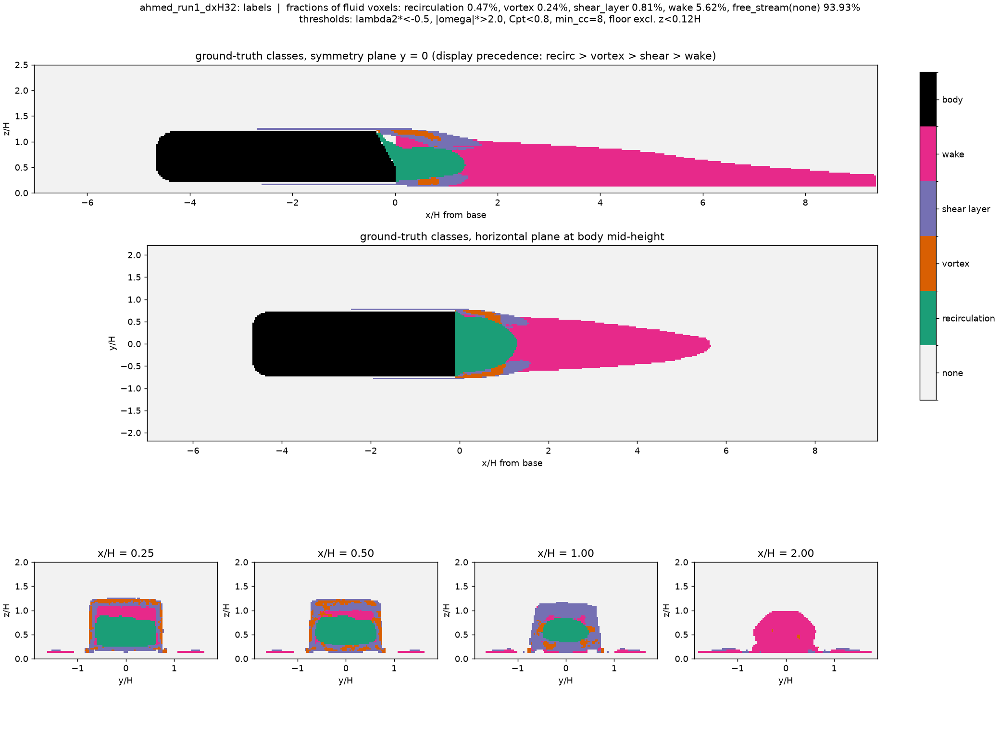
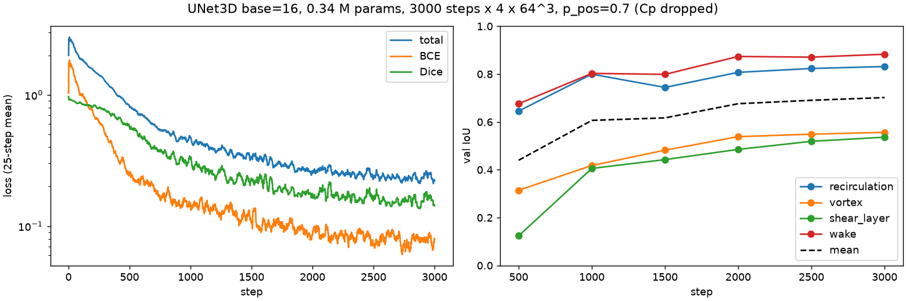
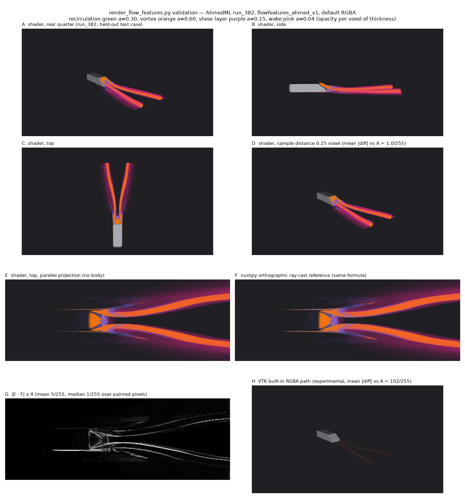

# Seeing the Flow: Learned Transfer Functions for CFD Volume Rendering

Look behind a car in a wind tunnel and you would find a tangle of structures: two counter-rotating trailing vortices, thin shear layers peeling off the roof and sides, a pocket of reversed flow behind the tail, and a long, slow wake. These structures largely determine drag and stability. Showing them clearly in a 3D CFD result is still more difficult than it should be.

Aim 2 of the VTK Innovation project uses AI to make good visualizations easier to produce. Our medical-imaging transfer-function work showed that a learned model can carry visual intent from one volume to another. This thrust applies that idea to fluid flow.

## 1. The Challenge

The usual way to volume render a flow feature is to compute a scalar, such as the Q-criterion, the λ₂-criterion, or vorticity magnitude, and build a transfer function on it. Each step requires a threshold. If one chooses a too low of a threshold, the volume rendering starts to display unwanted colored regions. If one sets the threshold too high, then the vortex disappears halfway down the wake. Shear layers and vortices both produce high vorticity, so a single scalar mixes them. Near walls and on coarse cells, the gradients behind all of these criteria become unreliable.

We measured this effect directly. Across 24 Ahmed-body simulations, the trailing-vortex core fell below the λ₂ threshold three body heights downstream in several cases, but not in others. Near a 30–35° slant angle, where the Ahmed body's wake changes from detached to attached, the recirculation and wake statistics changed sharply. We realized that a threshold which works for one geometry does not reliably work for the next variation of the same body.

## 2. The Implementation

Our approach is to classify the features first and render them second.

A neural network reads five channels per voxel: the three velocity components normalized by the free-stream speed, the pressure coefficient, and a mask that marks fluid voxels. It outputs four independent probabilities: **recirculation, vortex, shear layer, and wake**. A custom VTK GPU shader treats those four probabilities as layers. Each layer has its own color and its own opacity per unit thickness, and the shader blends them along each ray. The user chooses colors and opacities; they do not have to tune a threshold.

The training data is AhmedML, a public set of 499 high-fidelity simulations of the Ahmed body with slant angles from 6° to 70°. A VTK pipeline reads each native mesh, computes Q, λ₂, vorticity, and total pressure there, resamples everything onto a uniform grid at 1/32 of the body height, and applies a fixed set of label rules. The network never sees those derived quantities. It must learn the gradient structure from velocity and pressure alone. Runs are split by slant angle, so the test set contains geometries the model has never seen.

The labels show how small the targets are. In a typical case, vortex cores make up only 0.24% of fluid voxels, and about 94% of the domain is free stream. The leading architecture is a 3D U-Net, an encoder–decoder with skip connections that sees both large-scale context and fine detail. We will compare it with a plain 3D CNN and other variants.

## 3. The Example

A first U-Net baseline has 0.34 million parameters, small enough for interactive use. We trained it for 3,000 steps on 64³ patches.

Wake and recirculation are already well predicted, with validation IoU of about 0.88 and 0.83. Vortex and shear layer are around 0.55. That is the expected order, because these thin, gradient-defined structures are where architecture choice matters most. All four curves were still rising when training stopped.

On the rendering side, we checked the shader against an independent NumPy ray caster that uses the same blending formula. The median difference was 1/255. VTK's existing built-in RGBA volume path, tried on the same scene, almost lost the features entirely, with a mean difference of 102/255. That result justified writing the custom shader.

The result, shown at the top of this post for a held-out geometry, is a single image that shows the *orange* trailing vortices, *purple* shear layers, and *pink* wake together, each in its own color.

## 4. Why This Matters?

Engineers should spend their time interpreting flow, not adjusting thresholds. A four-channel shader gives users direct control over what they see in terms they already use: **vortex**, **shear**, **wake**, and **recirculation**.

For VTK, the work connects VTK data processing, GPU volume rendering, and modern ML in one pipeline. It also gives Aim 2's transfer-function research a scientific-data counterpart to the medical example.

## 5. Conclusion

The data pipeline, label audit, first baseline, and validated shader are in place. Next, we will compare architectures, calibrate per-class thresholds on validation data, and report test results by wake regime. After that, we plan to test transfer to WindsorML, DrivAerML, and HiLiftAeroML and to export to ONNX for GPU inference inside ParaView.
