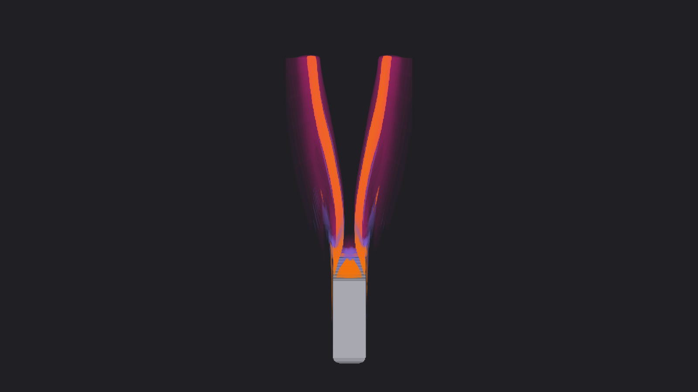
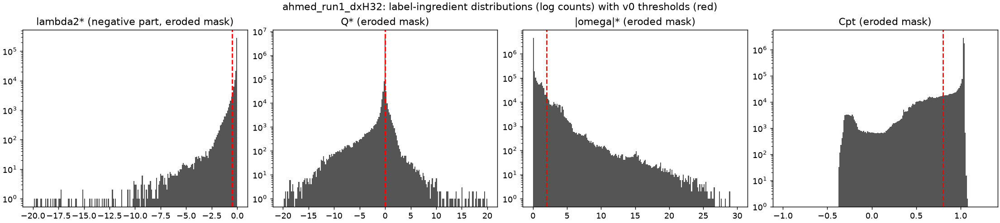
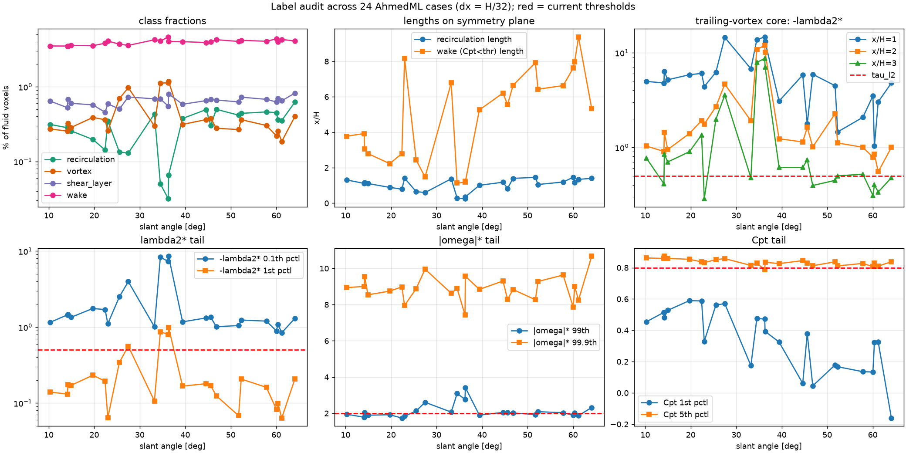
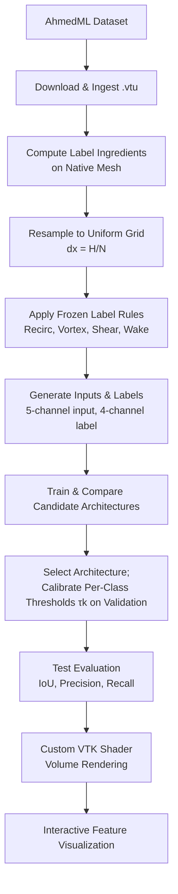

# Flow-Feature Transfer Functions Detailed Technical Report

## 1. Background and motivation

In CFD for automotive and aerodynamic design, engineers look for flow features such as vortices, shear layers, wakes, and recirculation zones because they govern drag, lift, and stability. Volume rendering can show these features in three dimensions. In practice, though, the transfer function is usually built on a single derived scalar, such as the Q-criterion, the λ₂-criterion, or vorticity magnitude, and requires a threshold that the user tunes by hand.

These criteria have known weaknesses:

- **Threshold dependence.** Q (Hunt, Wray & Moin 1988) and λ₂ (Jeong & Hussain 1995) identify vortex cores only once a cut-off is chosen. The Δ-criterion of Chong, Perry & Cantwell (1990) belongs to the same family and has the same issue.
- **Mesh and near-wall sensitivity.** Gradient-based quantities are noisy near walls and on poorly resolved cells.
- **Misclassification.** Shear layers produce high vorticity without swirling, so a vorticity threshold mixes the two.

Aim 2's medical transfer-function work showed that a known visualization can guide a learned mapping. Our July 2026 discussion of extending that work to CFD found the missing step: a scientific feature must first be characterized, much as segmentation does for anatomy. This thrust provides that characterization as four learned feature probabilities, which then become the color and opacity channels of a volume rendering.

## 2. Problem definition

The goal is to **identify a neural-network architecture** that:

- reads the non-dimensional velocity **u**/U∞ and the pressure coefficient Cp;
- predicts per-voxel probabilities for **recirculation, vortex, shear layer, and wake**; and
- feeds those probabilities to a custom VTK volume-rendering shader for interactive feature-based visualization without manual thresholds.

The 3D U-Net is the leading candidate and the proposed baseline. The final choice will depend on the evaluation in Section 7.

## 3. Literature

| Work | Contribution to this thrust |
|---|---|
| Ahmed, Ramm & Faltin (1984) | Introduced the Ahmed body benchmark and showed that slant angle controls the transition between attached and detached wake regimes. |
| Hunt, Wray & Moin (1988); Jeong & Hussain (1995) | Defined the Q- and λ₂-criteria, the standard vortex identifiers. They are also the label ingredients here, which illustrates their threshold sensitivity. |
| Chong, Perry & Cantwell (1990) | Δ-criterion; another member of the same family of criteria. |
| Ashton et al. (2024), AhmedML | 499 high-fidelity Ahmed-body runs with time-averaged velocity and pressure. This is the training data. |
| Ashton et al. (2024, 2026): WindsorML, DrivAerML, HiLiftAeroML | Related datasets that are natural targets for generalization. |
| Ronneberger, Fischer & Brox (2015); Çiçek et al. (2016) | U-Net and 3D U-Net: encoder–decoder networks with skip connections for dense volumetric prediction. |
| Milletari, Navab & Ahmadi (2016), V-Net | Volumetric segmentation and the Dice-style overlap loss. |

These three views of AhmedML run 382 show the target visual result. Trailing vortices are orange, shear layers are purple, the wake is a faint pink envelope, and recirculation behind the base is green. Each feature has its own hand-crafted color and opacity.

## 4. Data curation

### 4.1 Source

AhmedML (Hugging Face `neashton/ahmedml`) provides **499 runs** with slant angles from 6° to 70° and time-averaged `UMean` and `pMean` fields on native unstructured `.vtu` meshes. WindsorML, DrivAerML, and HiLiftAeroML are planned as later sources.

### 4.2 Pipeline (`build_training_case.py`)

For each run the pipeline:

1. **Reads** the native unstructured grid.
2. **Computes label ingredients on the native mesh** using `vtkGradientFilter`. The velocity gradient gives the strain-rate tensor S and the rotation tensor W, from which Q, λ₂, and |ω| are computed. It also computes Cpt = Cp + |u|²/U∞² and a reversed-flow flag (u/U∞ < −10⁻⁶).
3. **Resamples** the inputs and ingredients together onto a uniform `vtkImageData` grid at dx = H/N. With N = 32 the grid is 527 × 142 × 81 voxels and spans about −7H to +9.5H in streamwise distance from the base.
4. **Applies fixed label rules** (Section 4.4).
5. **Writes** three volumes (`_inputs.vti`, `_ingredients.vti`, `_labels.vti`), matching `.npz` arrays, and a metadata `.json` file that records every threshold.

`batch_build_cases.py` runs downloads and builds at the same time. A downloader thread stays at most one run ahead of the worker pool, skips runs that are already built, and by default deletes raw `.vtu` files after a successful build to limit disk usage.

### 4.3 Non-dimensionalization

| Quantity | Non-dimensional form |
|---|---|
| Position | x\* = x / H |
| Velocity | u\* = u / U∞ |
| Q | Q\* = Q · H² / U∞² |
| λ₂ | λ₂\* = λ₂ · H² / U∞² |
| Vorticity | \|ω\|\* = \|ω\| · H / U∞ |
| Pressure | Cp = 2(p − p₀) / (ρU∞²) |
| Total pressure | Cpt = Cp + \|u\|² / U∞² |

### 4.4 Label rules (v1)

| Feature | Rule | Notes |
|---|---|---|
| Recirculation | u/U∞ < −10⁻⁶ | Connected components < 8 voxels are removed |
| Vortex | λ₂\* < −0.5 **and** Q\* > 0 | Wall-eroded mask; z ≥ 0.12H |
| Shear layer | \|ω\|\* > 2 **and not** vortex | Wall-eroded mask; z ≥ 0.12H |
| Wake | Cpt < 0.8 **and** x > x_base | Wall-eroded mask; z ≥ 0.12H |

The wall-eroded mask removes voxels next to the body and floor, where gradients are unreliable. The floor exclusion (z < 0.12H) removes the boundary layer of the stationary wind-tunnel floor, which would otherwise be labeled as shear and wake.

### 4.5 Network inputs and outputs

**Inputs, 5 channels:** u/U∞, v/U∞, w/U∞, Cp, and a validity mask that marks fluid and body voxels.

**Outputs, 4 channels:** probabilities for recirculation, vortex, shear layer, and wake, each with its own sigmoid. The classes are not mutually exclusive.

The label ingredients (Q\*, λ₂\*, |ω|\*, Cpt) are used only to create labels. The network never sees them and must learn the gradient structure from the primitive fields.

The labels for run 1 show the expected structure: a green recirculation bubble behind the base, orange vortex cores and purple shear layers along the separating edges, and a pink wake that narrows downstream to about 9H. Fluid-voxel fractions are **recirculation 0.47%, vortex 0.24%, shear layer 0.81%, wake 5.62%, and unlabeled 93.93%**.

### 4.6 Splits

Runs are split into training, validation, and test sets **by geometry (slant angle)**, not by voxels or patches. The test set is held out entirely and spans the range of wake regimes, so evaluation measures generalization to unseen geometries.

## 5. Label audit

Before training, we checked the ingredient distributions and class statistics.

For run 1, the λ₂\* threshold (−0.5) falls in the steep part of the negative tail, Q\* > 0 splits a sharply peaked distribution, the |ω|\* threshold (2) sits at the knee of a long tail, and the Cpt threshold (0.8) sits just below the free-stream peak near 1.0.

Across 24 cases (dx = H/32) the audit found the following:

- **Imbalance is consistent.** Wake makes up about 3–5% of fluid voxels, shear layer about 0.5–0.8%, and vortex and recirculation about 0.1–1%.
- **The regime transition is visible.** Near 33–37°, recirculation drops by an order of magnitude, recirculation length on the symmetry plane approaches zero, and vortex fraction peaks. This matches the Ahmed body's known attached/detached transition.
- **Wake length varies widely.** The length of the Cpt < 0.8 region ranges from about 1H to 9H and is irregular across slant angles.
- **Trailing-vortex decay crosses the threshold.** At x/H = 3, the peak −λ₂\* in the trailing-vortex core falls below τ_λ₂ = 0.5 for several cases, so the vortex label ends partway along the vortex.
- **Thresholds sit on distribution tails.** The 99th percentile of |ω|\* is near 2 in most cases, and the 5th percentile of Cpt is near 0.8. Small threshold changes therefore move many voxels between classes.

These findings support the motivation for the project: fixed thresholds behave differently across geometries. They also mean the labels are a fixed teacher with known limits, not an absolute ground truth.

## 6. Machine-learning approach

### 6.1 Architectural requirements

1. **Receptive field larger than one voxel.** Every feature is defined by spatial gradients, such as vortex cores and shear-layer boundaries.
2. **Multi-scale context.** The model must separate shear layers a few voxels thick from wake structures that span many body heights.

### 6.2 Candidates

| Candidate | Rationale |
|---|---|
| **3D U-Net** (Çiçek et al. 2016) | Leading candidate. The encoder–decoder with skip connections gives a multi-scale receptive field while keeping fine detail. It is compact, trains quickly on random patches, and applies to full volumes with a sliding window. |
| **Plain 3D CNN** (no downsampling) | Tests whether multi-scale context is actually needed. |
| **Variants** | Different depth and width, attention blocks, and residual blocks, as the comparison warrants. |

Each candidate is judged on per-class accuracy, robustness across wake regimes, model size, and inference cost for interactive use.

### 6.3 Training and calibration harness

- **Training:** every candidate uses the same data, patch sampling, and loss. The baseline loss is binary cross-entropy plus Dice.
- **Calibration:** a per-class decision threshold τₖ is chosen on the validation set to maximize IoU.
- **Rendering:** a custom VTK GPU shader blends the four probability channels into one RGBA volume.

### 6.4 Baseline result

The first baseline used these settings:

| Setting | Value |
|---|---|
| Model | UNet3D, base width 16, 0.34M parameters |
| Steps | 3,000 |
| Batch | 4 patches of 64³ voxels |
| Positive-patch sampling | p_pos = 0.7 |
| Loss | BCE + Dice |
| Inputs | Cp channel dropped for this run |

The training loss fell steadily from about 2.5 to about 0.25. BCE fell below 0.1, and Dice settled near 0.15. Validation IoU at step 3,000, read from the curves, was:

| Class | Validation IoU |
|---|---|
| Wake | ≈ 0.88 |
| Recirculation | ≈ 0.83 |
| Vortex | ≈ 0.56 |
| Shear layer | ≈ 0.54 |
| **Mean** | **≈ 0.70** |

Vortex and shear layer are the hardest classes because they are thin and defined by gradients. This is where the architecture choice should matter most. All four classes were still improving at step 3,000, so the baseline has not converged. This is a single preliminary run. It is not the calibrated test evaluation described in Section 7.

## 7. Evaluation protocol

The selected model is evaluated on the held-out test geometries using **per-class IoU, precision, and recall** at the calibrated thresholds τₖ. Results are broken down by wake regime so that weaknesses near the critical slant angle remain visible.

## 8. Rendering

The four channels are rendered with a custom VTK GPU shader. Each class has a user-defined color and an opacity per voxel of thickness. The defaults are recirculation green with α = 0.30, vortex orange with α = 0.60, shear layer purple with α = 0.15, and wake pink with α = 0.04.

We validated the shader on held-out run 382:

- **Views (A–C):** the rear-quarter, side, and top views render the trailing vortex pair, the shear layers, and the wake envelope consistently.
- **Sampling stability (D):** reducing the sample distance to 0.25 voxel changes the image by a mean of only 1.0/255.
- **Independent reference (E–G):** a NumPy orthographic ray caster that uses the same compositing formula agrees with the parallel-projection shader to a mean of 5/255 and a median of 1/255 over painted pixels. The remaining differences are concentrated along thin vortex edges.
- **Built-in path (H):** VTK's experimental built-in direct-RGBA volume path differs by a mean of 102/255 and nearly loses the features. This is why the custom shader is required.

## 9. Project flow

## 10. Current status

| Component | Status |
|---|---|
| AhmedML ingestion and batch builder | Working |
| Label ingredients, resampling, label rules v1 | Working; audited on 24 cases |
| 3D U-Net baseline | First run complete; mean validation IoU ≈ 0.70 |
| Plain-CNN and variant comparison | Planned |
| Per-class threshold calibration and test evaluation | Planned |
| Custom four-channel VTK shader | Working; validated against a NumPy reference |

## 11. Risks and limitations

- **Label fidelity.** The labels come from the same threshold criteria the project aims to replace. The network learns to reproduce, and possibly smooth, the v1 rules. It does not learn an independent physical truth. The audit shows several thresholds close to distribution tails.
- **Class imbalance.** About 94% of fluid voxels are unlabeled, and vortex covers only about 0.1–1%. This makes positive-patch sampling and overlap losses necessary.
- **Regime shift.** Behavior changes sharply near a slant angle of 30–35°, so splitting by geometry is essential and per-regime reporting is needed.
- **Resolution.** dx = H/32 may under-resolve thin shear layers. The resolution study is not complete.
- **Rendering path.** The result depends on a custom shader rather than VTK's standard RGBA volume path.

## 12. Impact and future work

The project aims to show that ML can automate flow-feature identification without manual threshold tuning, and to identify which architecture does so best. Follow-on work could include:

1. **Cross-dataset transfer** to WindsorML, DrivAerML, and HiLiftAeroML.
2. **ONNX export** for GPU inference in ParaView.
3. **Specialized presets**, such as body-type-specific models for SUVs or airfoils.

## 13. References

1. Ahmed, S. R., Ramm, G., Faltin, G. (1984). Some salient features of the time-averaged ground vehicle wake. *SAE Technical Paper* 840300. [doi:10.4271/840300](https://doi.org/10.4271/840300)
2. Hunt, J. C. R., Wray, A. A., Moin, P. (1988). Eddies, streams, and convergence zones in turbulent flows. *CTR Proceedings of the Summer Program 1988*, 193–208.
3. Jeong, J., Hussain, F. (1995). On the identification of a vortex. *J. Fluid Mech.* 285, 69–94. [doi:10.1017/S0022112095000462](https://doi.org/10.1017/S0022112095000462)
4. Chong, M. S., Perry, A. E., Cantwell, B. J. (1990). A general classification of three-dimensional flow fields. *Phys. Fluids A* 2, 765–777. [doi:10.1063/1.857730](https://doi.org/10.1063/1.857730)
5. Ashton, N., et al. (2024). AhmedML. [arXiv:2407.20801](https://arxiv.org/abs/2407.20801). Data: [huggingface.co/datasets/neashton/ahmedml](https://huggingface.co/datasets/neashton/ahmedml)
6. Ashton, N., et al. (2024). WindsorML. *NeurIPS 2024 Datasets and Benchmarks*. [arXiv:2407.19320](https://arxiv.org/abs/2407.19320)
7. Ashton, N., et al. (2024). DrivAerML. [arXiv:2408.11969](https://arxiv.org/abs/2408.11969)
8. Ashton, N., et al. (2026). HiLiftAeroML. [arXiv:2605.19565](https://arxiv.org/abs/2605.19565). Data: [huggingface.co/datasets/nvidia/HiLiftAeroML](https://huggingface.co/datasets/nvidia/HiLiftAeroML)
9. Ronneberger, O., Fischer, P., Brox, T. (2015). U-Net. *MICCAI 2015*. [arXiv:1505.04597](https://arxiv.org/abs/1505.04597)
10. Çiçek, Ö., et al. (2016). 3D U-Net. *MICCAI 2016*. [arXiv:1606.06650](https://arxiv.org/abs/1606.06650)
11. Milletari, F., Navab, N., Ahmadi, S.-A. (2016). V-Net. *3DV 2016*. [arXiv:1606.04797](https://arxiv.org/abs/1606.04797)
