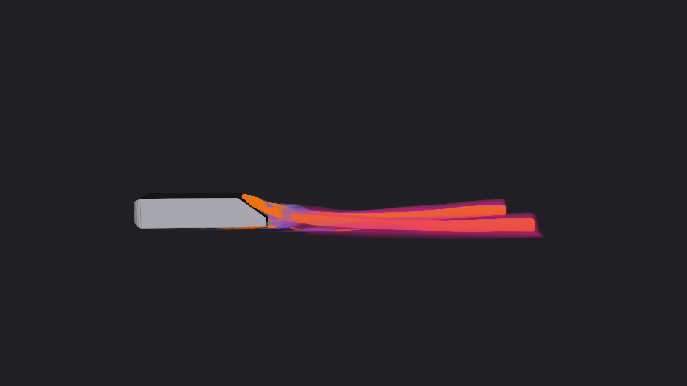

# Flow-Feature Transfer Functions Technical Report

## Purpose

This thrust applies Aim 2's AI transfer-function work to CFD volume rendering. It replaces hand-tuned thresholds on vortex and shear criteria with a learned, per-voxel classification of four flow features: **recirculation, vortex, shear layer, and wake**. Those four probabilities then drive a custom VTK volume-rendering shader. The aim is interactive, feature-based visualization that does not require manual threshold tuning.

## Problem

Automotive and aerodynamic analysis depends on finding vortices, shear layers, wakes, and recirculation zones. Standard gradient-based criteria, Q (Hunt, Wray & Moin 1988), λ₂ (Jeong & Hussain 1995), and vorticity magnitude, each require a manually chosen threshold, are sensitive to mesh quality and near-wall effects, and can misclassify structures. Volume rendering these criteria inherits all of these problems through the transfer function.

## Approach

- **Inputs (5 channels):** u/U∞, v/U∞, w/U∞, the pressure coefficient Cp, and a fluid/body validity mask.
- **Outputs (4 channels):** independent sigmoid probabilities for recirculation, vortex, shear layer, and wake.
- **Architecture study:** the 3D U-Net (Çiçek et al. 2016) is the baseline. It will be compared with a plain 3D CNN without downsampling and with depth, width, attention, and residual variants, all under the same data, loss, and evaluation protocol.
- **Rendering:** a custom VTK GPU shader blends the four probability channels into RGBA using colors and opacities chosen by the user.

## Data

The data comes from AhmedML (Ashton et al. 2024; Hugging Face `neashton/ahmedml`): 499 time-averaged runs with slant angles from 6° to 70°. A VTK pipeline handles each run in four steps:

1. Read the native `.vtu` mesh.
2. Compute Q\*, λ₂\*, |ω|\*, Cpt, and a reversed-flow flag on that mesh.
3. Resample onto a uniform grid at dx = H/32 (527 × 142 × 81 voxels).
4. Apply fixed label rules:

| Feature | Rule |
|---|---|
| Recirculation | u/U∞ < −10⁻⁶; connected components ≥ 8 voxels |
| Vortex | λ₂\* < −0.5 and Q\* > 0 |
| Shear layer | \|ω\|\* > 2 and not vortex |
| Wake | Cpt < 0.8 and downstream of the base |

Vortex, shear-layer, and wake labels are computed on a wall-eroded mask and exclude the wind-tunnel floor boundary layer (z < 0.12H). Runs are split by slant angle, and the test set is held out entirely.

## Progress

- **Data pipeline:** working end to end, with a batch builder that downloads runs from Hugging Face while processing earlier ones.
- **Label audit:** run across 24 cases. Classes are highly imbalanced, about 94% of fluid voxels are unlabeled, and recirculation and wake length change sharply near the critical slant angle of about 30–35°.
- **Baseline training:** a 3D U-Net (base width 16, 0.34M parameters, 3,000 steps × 4 × 64³ patches, BCE + Dice) reached a validation IoU of about 0.88 for wake, 0.83 for recirculation, 0.56 for vortex, and 0.54 for shear layer. The mean was about 0.70.
- **Shader validation:** on held-out run 382, the custom shader matched a NumPy ray-cast reference to a median of 1/255. VTK's built-in direct-RGBA path differed by 102/255.

## Next steps

1. Compare the candidate architectures on per-class IoU, robustness across wake regimes, model size, and inference cost.
2. Choose per-class decision thresholds τₖ on validation data and report test IoU, precision, and recall.
3. Transfer to WindsorML, DrivAerML, and HiLiftAeroML.
4. Export to ONNX for GPU inference in ParaView, and build body-type-specific presets.
